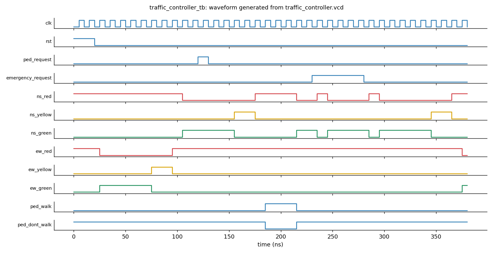
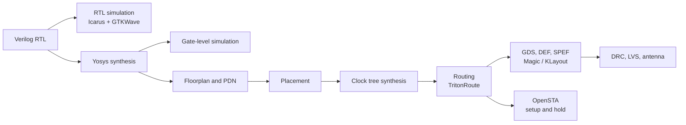

# Smart Traffic Light Controller: Verilog RTL to GDS


A finite-state-machine traffic light controller for a two-road intersection with a latched pedestrian request and an
emergency-priority input, taken through the digital ASIC flow: RTL simulation, synthesis, gate-level simulation,
place and route to GDS with OpenLane, and static timing analysis with OpenSTA.

> **Educational prototype.** Not a certified traffic controller. Do not use it to control real traffic.



*Waveform of `tb/traffic_controller_tb.v` on `rtl/traffic_controller.v`, generated by `scripts/plot_waveform.py`.*

## Status at a glance

| Area | Result | Details |
|---|---|---|
| RTL simulation (provided testbench) | Compiles cleanly, no safety violation, finishes at 380 ns | [docs/02](docs/02-verification.md) |
| Gate-level simulation (screenshot) | 6/6 PASS, 90 safety checks | [docs/02](docs/02-verification.md) |
| OpenLane flow | Completed in 2 min 3 s, no fatal errors | [docs/04](docs/04-physical-design.md) |
| Routing | TritonRoute violations 0; wire length 2973; 774 vias | [docs/04](docs/04-physical-design.md) |
| LVS / antenna | 0 errors / 0 pins and 0 nets violated | [docs/04](docs/04-physical-design.md) |
| Mapped cells | 104 standard cells | [docs/04](docs/04-physical-design.md) |
| Timing (OpenSTA, ss_100C_1v60, 20 ns ideal clock) | Setup slack **+10.61 ns**, hold slack **+1.19 ns** | [docs/05](docs/05-timing-analysis.md) |
| Magic DRC | **0** in the OpenLane batch flow, **491** in interactive Magic | [docs/06](docs/06-drc-investigation.md) |

### Open items (read before relying on the numbers)

1. **DRC discrepancy, unresolved.** OpenLane reports 0 Magic violations, interactive Magic shows `DRC=491`. This layout is not
   claimed to be DRC-clean. Debug plan: [docs/06](docs/06-drc-investigation.md).
2. **Evidence and source do not fully match.** The synthesis screenshot shows synchronous-reset registers, one 64-bit array and
   23 public wire bits; the RTL in `rtl/` uses asynchronous reset, has no array and has 33 public bits. The gate-level and
   waveform screenshots come from a testbench that prints `PASS:` lines and counts 90 checks, which is not
   `tb/traffic_controller_tb.v`. The physical-design and timing numbers therefore describe the design revision run on
   `10-10_08-33`. Re-run the flow on the final RTL to align them ([docs/03](docs/03-synthesis.md)).
3. **Timing is simplified**: ideal clock, one corner, placeholder I/O delays. Not signoff.

## Flow



## The design

| Port | Dir | Description |
|---|---|---|
| `clk` | in | Clock |
| `rst` | in | Asynchronous active-high reset, enters all-red |
| `ped_request` | in | Pedestrian button, latched until served |
| `emergency_request` | in | Emergency priority |
| `ns_red/yellow/green`, `ew_red/yellow/green` | out | Signal heads |
| `ped_walk`, `ped_dont_walk` | out | Pedestrian indications |

9-state FSM, 4-bit state, 16-bit phase timer, durations as parameters (defaults: green 10, yellow 3, all-red 2, walk 5 cycles).
Normal cycle: `ALL_RED_1 -> EW green -> EW yellow -> ALL_RED_2 -> NS green -> NS yellow -> ALL_RED_1`. A latched pedestrian
request is served from either all-red state; an emergency request goes to all-red and then holds NS green until released.
State table and diagram: [docs/01](docs/01-design-overview.md).

## Key findings

1. **Safety behaviour holds in simulation.** Greens never overlap, walk happens only while both roads are red, and every
   direction change passes through all-red (provided testbench re-run, plus the gate-level screenshot).
2. **Design review found a fairness bug, confirmed in simulation.** After a pedestrian crossing the FSM always returns to
   NS green, so a crossing inserted after the NS phase gives NS two greens in a row and EW waits 280 ns with the testbench
   parameters. Other notes: no yellow on emergency entry/exit, unsynchronised async inputs, combinational outputs, oversized
   16-bit timer ([docs/01](docs/01-design-overview.md)).
3. **Timing has wide margin** under the simplified constraints: the 20 worst setup paths are all input-to-register
   (`emergency_request` worst at 10.61 ns); worst hold paths are flop-to-flop feedback (1.19 ns). A rough indication is that
   the worst path class would fit in about 9.4 ns, not an Fmax claim.
4. **Routing is concentrated in the core centre** (met1 64.6 %, met2 33.3 % of 717 segments); a smaller die or lower
   utilisation target is worth trying.
5. **Synthesis**: the screenshot shows a small design (44 generic cells, 3 registers, 14 comparators) mapped to 104 cells;
   it does not match the provided RTL (see open item 2).

## Layout


## Repository structure

```
.
├── README.md
├── LICENSE
├── rtl/traffic_controller.v          design source
├── tb/
│   ├── traffic_controller_tb.v       provided testbench
│   └── README.md                     what it checks; note about the second (GLS) testbench
├── openlane/                         config template and notes
├── sta/traffic_controller_sta.tcl    OpenSTA script
├── scripts/
│   ├── plot_waveform.py              VCD -> waveform image + phase timeline
│   ├── summarize_run.py              print the OpenLane summary CSV
│   ├── run_sta.sh                    run OpenSTA
│   └── open_layout.sh                open the GDS in Magic
└── docs/
    ├── 00-evidence-index.md          every image and what it proves
    ├── 01-design-overview.md         FSM, state table, design review
    ├── 02-verification.md
    ├── 03-synthesis.md
    ├── 04-physical-design.md
    ├── 05-timing-analysis.md
    ├── 06-drc-investigation.md
    ├── 07-reproduce.md               all commands
    └── images/                       13 screenshots + 1 generated waveform
```

## Quick start

```bash
# RTL simulation (needs -g2012 for $fatal)
iverilog -g2012 -o sim rtl/traffic_controller.v tb/traffic_controller_tb.v
vvp sim
python3 scripts/plot_waveform.py traffic_controller.vcd docs/images/14-generated-waveform-provided-tb.png

# Full flow (inside the OpenLane container), then summary
./flow.tcl -design traffic_controller
python3 scripts/summarize_run.py designs/traffic_controller/runs/<run>/reports/final_summary_report.csv

# Timing
export PDK_ROOT=<path to pdks>
./scripts/run_sta.sh
```

Step-by-step commands, including gate-level simulation and layout viewing: [docs/07-reproduce.md](docs/07-reproduce.md).

## Next steps

- Add the second (self-counting) testbench used for the gate-level run to `tb/`.
- Re-run synthesis, OpenLane and STA on the final RTL and refresh the numbers.
- Resolve the Magic DRC discrepancy (`drc listall why`, re-check in the container, cross-check with KLayout).
- Fix the pedestrian-phase fairness issue; consider yellow on emergency transitions, input synchronisers, registered outputs.
- Timing: propagated clock after CTS, ss/tt/ff corners, real I/O constraints, capture `check_setup` output.

## License

MIT, see [LICENSE](LICENSE). Replace `<YOUR NAME>` in the license file.
