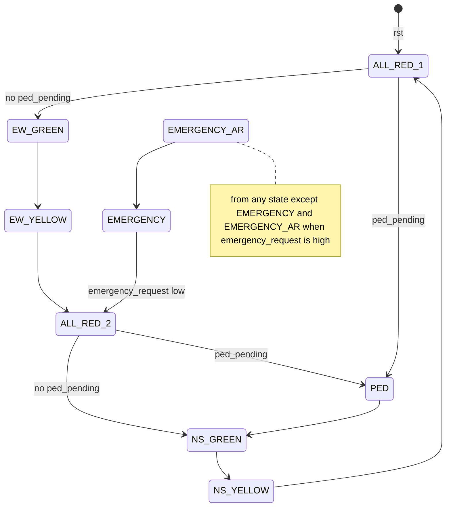

# Design overview

`traffic_controller` is a synchronous FSM controller for a two-road intersection (north-south and east-west) with a
latched pedestrian request and an emergency-priority input. Source: [`rtl/traffic_controller.v`](../rtl/traffic_controller.v).

## Interface

| Port | Dir | Meaning |
|---|---|---|
| `clk` | in | System clock |
| `rst` | in | **Asynchronous** active-high reset; enters `S_ALL_RED_1` |
| `ped_request` | in | Pedestrian button; sets `ped_pending` |
| `emergency_request` | in | Emergency priority; level-sensitive |
| `ns_red`, `ns_yellow`, `ns_green` | out | North-south signal heads |
| `ew_red`, `ew_yellow`, `ew_green` | out | East-west signal heads |
| `ped_walk`, `ped_dont_walk` | out | Pedestrian indications (always complementary) |

## Parameters (clock cycles)

| Parameter | Default | Testbench override |
|---|---|---|
| `NS_GREEN_TIME` | 10 | 5 |
| `NS_YELLOW_TIME` | 3 | 2 |
| `EW_GREEN_TIME` | 10 | 5 |
| `EW_YELLOW_TIME` | 3 | 2 |
| `ALL_RED_TIME` | 2 | 1 |
| `PED_WALK_TIME` | 5 | 3 |

A phase lasts exactly its parameter in cycles (`timer` counts 0 to `TIME-1`).

## State machine

Internal registers: `state[3:0]`, `timer[15:0]`, `ped_pending`.

| State | Code | Outputs | Leaves when | Next |
|---|---|---|---|---|
| `S_NS_GREEN` | 0 | NS green | timer done | `S_NS_YELLOW` |
| `S_NS_YELLOW` | 1 | NS yellow | timer done | `S_ALL_RED_1` |
| `S_ALL_RED_1` | 2 | all red | timer done | `S_PED` if `ped_pending`, else `S_EW_GREEN` |
| `S_EW_GREEN` | 3 | EW green | timer done | `S_EW_YELLOW` |
| `S_EW_YELLOW` | 4 | EW yellow | timer done | `S_ALL_RED_2` |
| `S_ALL_RED_2` | 5 | all red | timer done | `S_PED` if `ped_pending`, else `S_NS_GREEN` |
| `S_PED` | 6 | `ped_walk`=1, `ped_dont_walk`=0, vehicles red | timer done | `S_NS_GREEN` |
| `S_EMERGENCY` | 7 | **NS green** (demo policy) | `emergency_request` falls | `S_ALL_RED_2` |
| `S_EMERGENCY_AR` | 8 | all red | timer done | `S_EMERGENCY` |
| 9-15 | | (unreachable) | | `S_ALL_RED_1` |

Priority rules in the code:

1. `emergency_request` overrides everything except the two emergency states: any other state jumps to `S_EMERGENCY_AR`.
2. `ped_pending` is set by `ped_request` and cleared on the first clock in `S_PED`.
3. Outputs default to "all red, don't walk"; each state overrides only what it needs.

## Design review notes

Found by reading the code; items 1 and 6 were confirmed in simulation.

1. **Pedestrian crossing can starve EW.** `S_PED` always returns to `S_NS_GREEN`. If the crossing is inserted after
   `S_ALL_RED_1` (right after an NS phase), NS gets two greens in a row and EW is skipped. In the provided testbench run the NS phase (105-175 ns) is followed by the crossing (185-215 ns) and then by NS green again at 215 ns, so `ew_red` stays high from 95 ns until 375 ns (280 ns without any EW green). A fix is to
   remember which all-red state preceded `S_PED` and resume with the opposite direction.
2. **Emergency entry and exit skip yellow.** Entry jumps straight to all-red from any state (also from green), and exit goes
   from NS green directly to all-red. Acceptable as a demonstration policy, not for a real signal.
3. **Emergency interrupts a crossing without retry.** `ped_pending` is already cleared in the first cycle of `S_PED`, so a
   crossing cut short by an emergency is lost.
4. **Unsynchronised asynchronous inputs.** `ped_request`, `emergency_request` and the release of `rst` go straight into
   flops. In silicon use two-flop synchronisers (and a reset synchroniser) to avoid metastability.
5. **Combinational outputs.** Outputs are decoded from `state` with an `always @(*)` block, so decode glitches are possible.
   Registering the outputs gives glitch-free signal heads.
6. **Priority of set over clear.** If `ped_request` stays high during `S_PED`, `ped_pending` is re-set and another crossing
   follows immediately.
7. **Oversized timer.** `timer` is 16 bits but the largest count is 9 (4 bits are enough with the default parameters). Sizing it
   from the parameters cuts flops and comparator logic (about 16 flops and a wide `>=` per state today).
8. **Safe recovery.** Unreachable codes 9-15 fall to `S_ALL_RED_1`, which is good practice.
9. **No `` `timescale`` in the RTL** (the testbench has one); Icarus warns about it.

## Scope

Educational prototype for learning the RTL-to-GDS flow. Not a certified traffic controller; do not use it for real
intersections.
