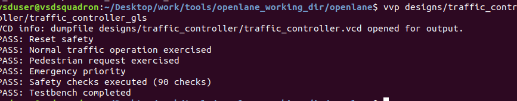
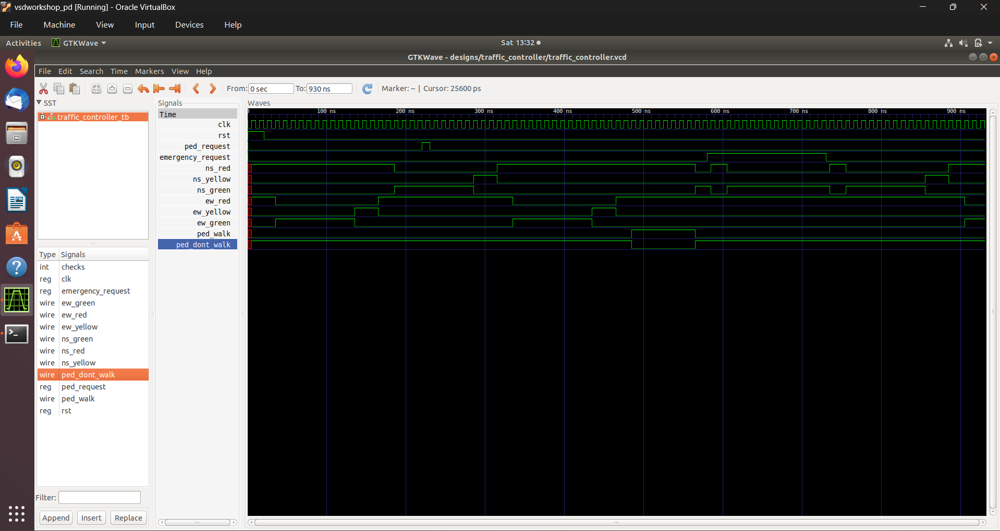

# Verification

There are **two testbenches** in play, and they are not the same:

| | Provided testbench (`tb/traffic_controller_tb.v`) | Testbench behind the screenshots |
|---|---|---|
| Output | Info messages and `Testbench completed.` | Six `PASS:` lines, "90 checks" |
| Counter signal `checks` | no | yes (visible in GTKWave) |
| Parameters | overridden to 5/2/5/2/1/3 cycles | RTL defaults (green 100 ns, yellow 30 ns, all-red 20 ns at 10 ns clock) |
| `ped_request` | at 120 ns | at about 221 ns |
| `emergency_request` | 230-280 ns (50 ns) | about 581-732 ns (150 ns) |
| Pedestrian walk length | 30 ns (3 cycles) | about 80 ns |
| Runs on netlist | no (parameter overrides do not apply to a netlist) | yes (gate-level run) |

Section 1 covers the provided testbench with results re-run for this repo. Section 2 covers the screenshot evidence.
Add the second testbench to `tb/` so both can be reproduced.

## 1. Provided testbench, RTL simulation

Re-run with Icarus Verilog (`iverilog -g2012`): compiles cleanly, no `$fatal`, finishes at 380 ns.

The image is generated from the VCD with [`scripts/plot_waveform.py`](../scripts/plot_waveform.py). Phase timeline from the same script:

| Time (ns) | Phase | Notes |
|---|---|---|
| 0 - 25 | All red | reset (released at 20 ns), `S_ALL_RED_1` |
| 25 - 75 | EW green | 5 cycles |
| 75 - 95 | EW yellow | 2 cycles |
| 95 - 105 | All red | 1 cycle |
| 105 - 155 | NS green | `ped_request` sampled at 125 ns, latched |
| 155 - 175 | NS yellow | |
| 175 - 185 | All red | `ped_pending` set, so next is `S_PED` |
| 185 - 215 | **Pedestrian walk** | 3 cycles, both roads red |
| 215 - 235 | NS green | resumes with NS, EW is skipped (see design note 1) |
| 235 - 245 | All red | emergency asserted at 230 ns, seen at the 235 ns clock edge |
| 245 - 285 | **NS green (emergency)** | held until release at 280 ns |
| 285 - 295 | All red | after release |
| 295 - 345 | NS green | normal NS phase |
| 345 - 365 | NS yellow | |
| 365 - 375 | All red | EW green follows at 375 ns |

What the testbench checks: no simultaneous greens and walk only while both roads are red (both pass). What it does not check:
`ped_walk`/`ped_dont_walk` complementarity, the all-red gap between directions, yellow-before-red order, the emergency
sequence, or that a latched request is eventually served. The `Pedestrian crossing active` message only prints, it does
not assert anything.

## 2. Screenshot evidence

### Gate-level simulation

| Check | Result |
|---|---|
| Reset safety | PASS |
| Normal traffic operation exercised | PASS |
| Pedestrian request exercised | PASS |
| Emergency priority | PASS |
| Safety checks executed | PASS, 90 checks |
| Testbench completed | PASS |

Command visible in the screenshot: `vvp designs/traffic_controller/traffic_controller_gls`, with the dump file
`designs/traffic_controller/traffic_controller.vcd`.

### Waveform (GTKWave)

Timeline read from the screenshot (approximate, 10 ns clock, default parameters):

| Time (ns) | Event |
|---|---|
| 0 - 25 | `rst` high |
| 36 - 136 | EW green (10 cycles) |
| 136 - 166 | EW yellow (3 cycles) |
| 166 - 187 | All-red (2 cycles) |
| 187 - 287 | NS green |
| 221 - 232 | **`ped_request` pulse** (one clock) |
| 287 - 316 | NS yellow |
| 316 - 336 | All-red |
| 336 - 436 | EW green |
| 436 - 466 | EW yellow |
| 466 - 486 | All-red |
| 486 - 566 | **`ped_walk` high** (`ped_dont_walk` low), both roads red |
| 566 - 586 | NS green |
| 581 - 732 | **`emergency_request` high** |
| 586 - 607 | All-red (emergency entry) |
| 607 - 736 | NS green held during emergency |
| 736 - 757 | All-red after release |
| 757 - 857 | Normal NS green restarts, yellow 857 - 885 |

This matches the RTL behaviour: reset starts in all-red then EW green, a pedestrian request is served at the next all-red
after the EW phase, emergency goes all-red then NS green, and release goes all-red then NS green. Two details do not match
the RTL defaults and should be checked: the walk lasts about 8 cycles whereas `PED_WALK_TIME` defaults to 5, and the
waveform has a `checks` signal that the provided testbench lacks. Most likely the screenshots come from a different
testbench and possibly a different revision of the RTL (see [03-synthesis](03-synthesis.md)).

The VCD name `traffic_controller.vcd` is used by RTL and gate-level runs alike, so confirm which run this capture came from.

## 3. Gaps and recommended next steps

- Add the second testbench (PASS lines and 90 checks) to the repo and keep one testbench that runs on both RTL and netlist.
- Re-run RTL and gate-level simulation on the final RTL, so the logs and waveforms match the source in `rtl/`.
- Add checks and scenarios: all-red between directions, yellow before red, emergency during yellow and during walk,
  `ped_request` and `emergency_request` together, reset mid-cycle, long `ped_request`.
- A directed test for design note 1 (pedestrian crossing starving EW) would currently expose that behaviour.
- Add timing-annotated gate-level simulation (SDF) after fixing the STA setup.
- Consider formal properties (mutual exclusion of greens, walk implies both red).
