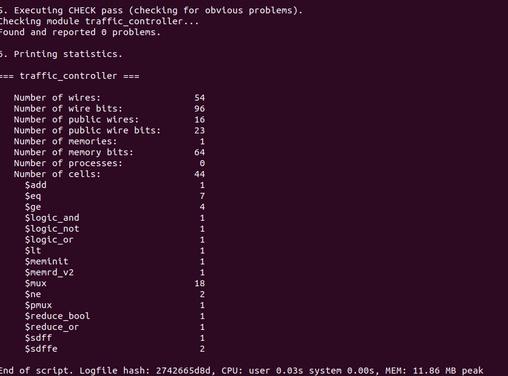

# Synthesis (Yosys)

## What the screenshot shows

- `CHECK pass`: "Found and reported 0 problems."
- CPU 0.03 s, 11.86 MB peak.
- These are **generic, pre-technology-mapping** statistics (Yosys internal cells), not `sky130_fd_sc_hd__*` cells.
  After mapping, OpenLane reports **104 standard cells** ([04-physical-design](04-physical-design.md)).

| Item | Screenshot |
|---|---|
| Wires / wire bits | 54 / 96 |
| Public wires / bits | 16 / 23 |
| Memories / memory bits | 1 / 64 |
| Total cells | 44 |
| Registers | `$sdff` 1, `$sdffe` 2 (synchronous reset) |
| Other cells | `$add` 1, `$eq` 7, `$ge` 4, `$lt` 1, `$ne` 2, `$mux` 18, `$pmux` 1, logic/reduce 5, `$meminit` 1, `$memrd_v2` 1 |

## Consistency warning: screenshot versus `rtl/traffic_controller.v`

The same flow was run on the RTL in this repo (`read_verilog; hierarchy; proc; flatten; opt; stat`, Yosys from Ubuntu):

| Item | Screenshot | Provided RTL |
|---|---|---|
| Public wires / bits | 16 / 23 | 15 / **33** |
| Memories / bits | 1 / 64 | **0 / 0** |
| Register type | `$sdff`, `$sdffe` (synchronous reset) | `$adffe` x3 (**asynchronous reset**) |
| Total cells | 44 | 68 |

Cell counts depend on the Yosys version and pass order, so the totals alone prove nothing. The structural differences do:
the provided RTL has no array (no memory), uses asynchronous reset (`posedge rst` in the sensitivity list), and has 33 public
bits (12 ports + 4 state + 16 timer + 1 pending) rather than 23. The screenshot design therefore had a smaller timer (about
11 internal bits in total), synchronous reset and a 64-bit initialised array.

Two more signs point the same way: the timing reports use `dfxtp_1` flops, which have no reset pin (an asynchronous reset
would map to `dfrtp_1`), and a plain Yosys `synth` of the provided RTL produces about 400 generic gates. That is not directly comparable to
a mapped cell count, but a 4x gap versus the reported 104 cells is a further hint.

**Conclusion:** the synthesis, OpenLane and STA numbers in this repo were produced from a different revision of the
design than the `rtl/traffic_controller.v` provided later. Either supply that revision (and the matching testbench) or,
better, re-run the whole flow on the final RTL and refresh the numbers. Until then treat the numbers as results for
"the version used in run `10-10_08-33`".

## Analysis of the screenshot design

- **Synchronous reset.** `$sdff`/`$sdffe` become plain D flops plus reset logic, matching the `dfxtp_1` endpoints in STA.
- **A 64-bit initialised array was inferred as a memory** and turned into combinational logic (too small for a macro).
  Check the RTL that was synthesised to see what it held (for example a phase-duration table).
- **Comparator-heavy control.** About 14 comparators for 3 registers suggests timer-versus-constant checks per phase.

## Observations on the provided RTL

- `timer` is 16 bits, but the longest phase is 10 cycles, so 4 bits would do. The comparators (`>=` per state) and
  incrementer are 16 bits wide, which is the main source of logic in the generic netlist.
- Asynchronous reset flops are larger than `dfxtp_1` and need reset-removal timing checks in STA.
- Suggested optimisation: size `timer` with `$clog2(max(parameters))`, or use a single down-counter that reloads per state.
