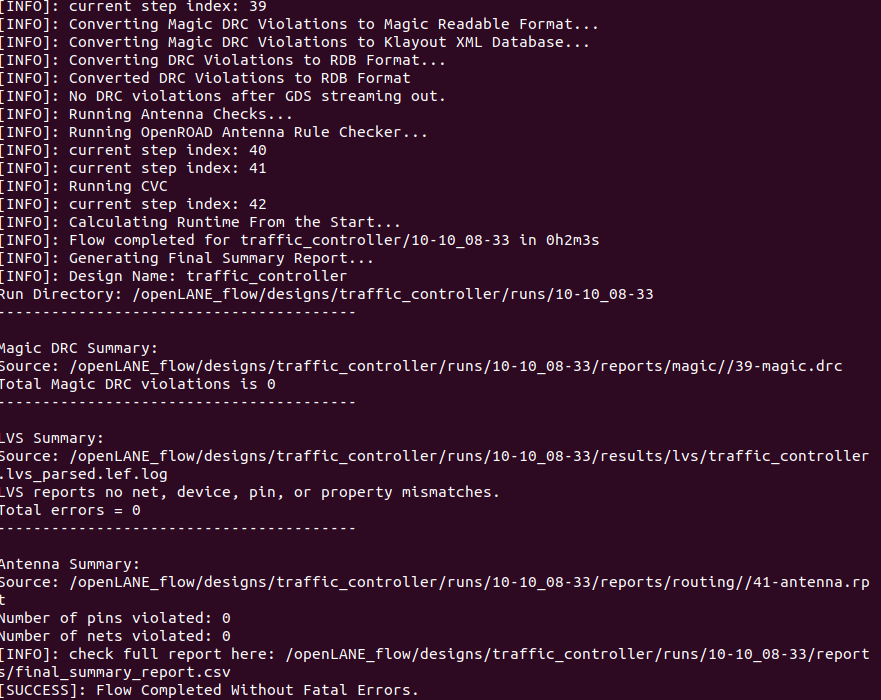
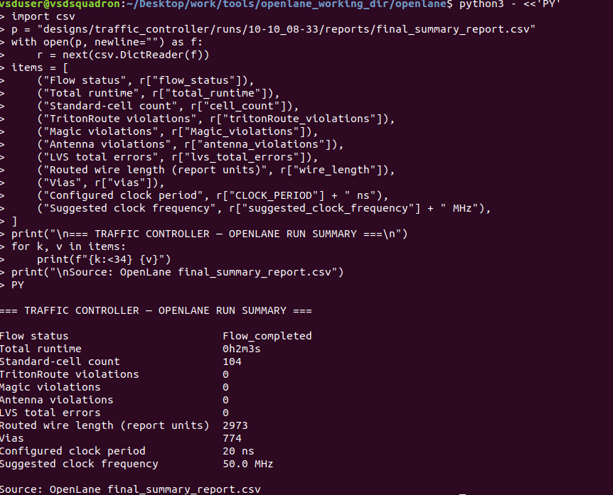
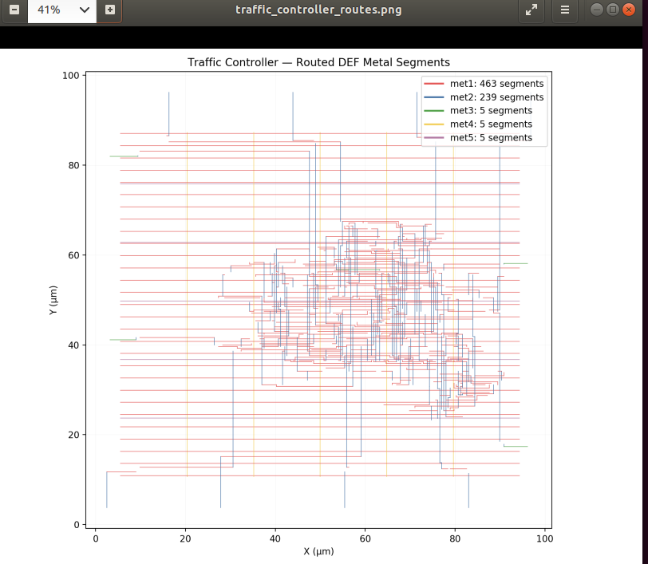

# Physical design (OpenLane v0.21, SKY130A, sky130_fd_sc_hd)

> **Version note.** These results belong to the design revision synthesised in run `10-10_08-33`. Its synthesis
> statistics do not match `rtl/traffic_controller.v` (see [03-synthesis](03-synthesis.md)). Re-run the flow on the final
> RTL before quoting these numbers as results for that file.

## Flow outcome

- Run directory: `/openLANE_flow/designs/traffic_controller/runs/10-10_08-33` (inside the OpenLane Docker container)
- Flow completed for `traffic_controller` in **0 h 2 m 3 s** (42 flow steps; final message
  `[SUCCESS]: Flow Completed Without Fatal Errors.`)
- Steps visible at the end: Magic DRC (step 39), antenna check with the OpenROAD antenna rule checker (40-41), CVC
  (electrical rule check), final summary report (42).

| Check (from the log) | Result |
|---|---|
| Magic DRC after GDS streaming | "No DRC violations after GDS streaming out", total Magic DRC violations 0 |
| LVS | "no net, device, pin, or property mismatches", total errors 0 |
| Antenna | pins violated 0, nets violated 0 |

## Summary CSV

| Metric | Value |
|---|---|
| Flow status | Flow_completed |
| Total runtime | 0h2m3s |
| Standard-cell count | 104 |
| TritonRoute violations | 0 |
| Magic violations | 0 |
| Antenna violations | 0 |
| LVS total errors | 0 |
| Routed wire length | 2973 (report units) |
| Vias | 774 |
| Configured clock period | 20 ns |
| Suggested clock frequency | 50.0 MHz |

Reading these numbers:

- `suggested_clock_frequency` is exactly 1 / `CLOCK_PERIOD` (1 / 20 ns = 50 MHz). It echoes the configuration; it is
  **not** a measured maximum frequency. See [05-timing-analysis](05-timing-analysis.md) for slack.
- 774 vias for 104 cells is about 7.4 vias per cell, typical for a small, signal-dense block routed mostly on
  met1/met2 with PDN straps above.
- The design is tiny (2 minutes end to end), so every iteration is cheap. That makes it a good candidate for sweeping
  utilisation and clock period.

## Routing

Segments parsed from the routed DEF:

| Layer | Segments | Share |
|---|---|---|
| met1 | 463 | 64.6 % |
| met2 | 239 | 33.3 % |
| met3 | 5 | 0.7 % |
| met4 | 5 | 0.7 % |
| met5 | 5 | 0.7 % |
| Total | 717 | 100 % |

Observations:

- The regular full-width horizontal met1 lines (x about 5-95 um) are the standard-cell power rails. The five vertical
  met4 lines are PDN straps. The five met3/met5 segments are minor connections.
  (Inferred from geometry, not from a layer-purpose report.)
- Signal routing is concentrated in the centre of the core (roughly x 35-90 um, y 25-68 um), so the periphery is mostly
  empty rail. A lower utilisation target or a smaller die would shrink wire length and area.
- Axes span about 100 um in each direction, so the whole block is on the order of 0.01 mm2.

The plot comes from a custom script that parses the DEF; that script is not part of the evidence, so it is not
included here.
