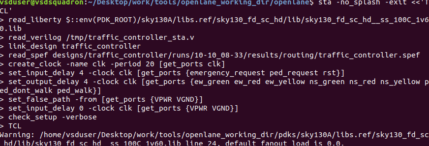
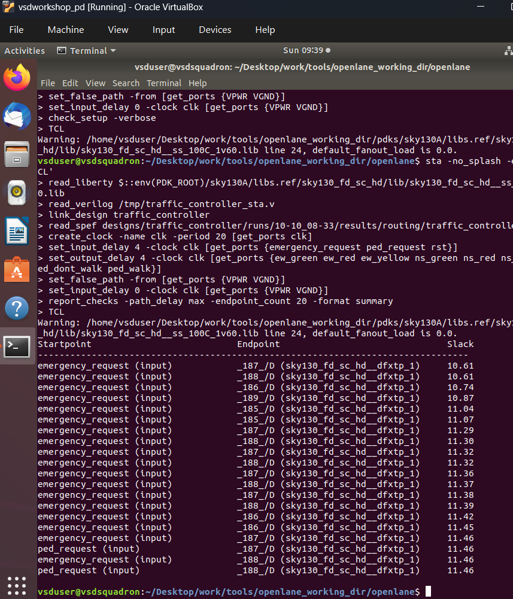
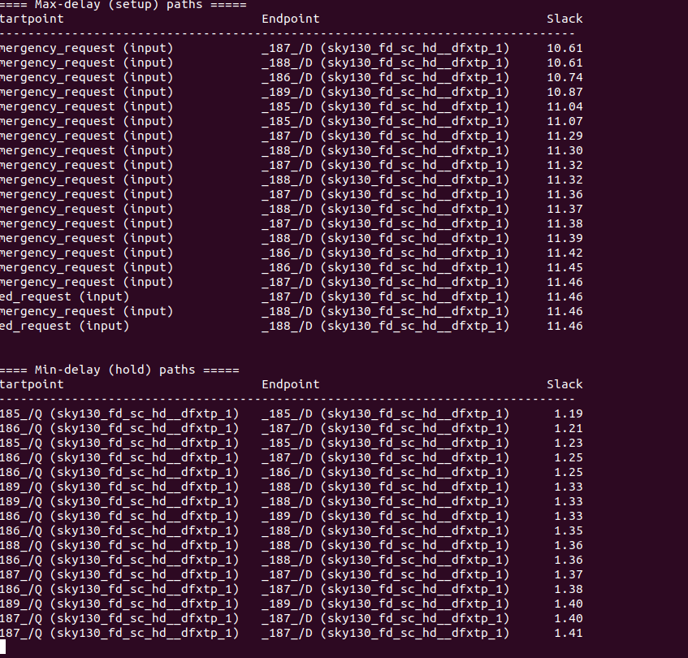

# Static timing analysis (OpenSTA)

A separate, simplified post-route OpenSTA run was done on the host (outside the OpenLane container).
Script: [`sta/traffic_controller_sta.tcl`](../sta/traffic_controller_sta.tcl)

## Setup

| Item | Value |
|---|---|
| Liberty corner | `sky130_fd_sc_hd__ss_100C_1v60` (slow-slow, 100 C, 1.60 V) |
| Netlist | `/tmp/traffic_controller_sta.v` (prepared separately) |
| Parasitics | post-route `traffic_controller.spef` from the OpenLane run |
| Clock | `create_clock -name clk -period 20` (**ideal**, 20 ns / 50 MHz) |
| Input delay | 4 ns on `emergency_request`, `ped_request`, `rst` |
| Output delay | 4 ns on all eight signal outputs |
| Other | `VPWR`/`VGND` set as false paths; `check_setup -verbose` run |

The liberty warning `default_fanout_load is 0.0` (line 24 of the lib) is a benign library message.

## Setup (max-delay) results

| Rank | Startpoint | Endpoint | Slack (ns) |
|---|---|---|---|
| 1 | `emergency_request` | `_187_/D` (dfxtp_1) | **10.61** |
| 2 | `emergency_request` | `_188_/D` | 10.61 |
| 3 | `emergency_request` | `_186_/D` | 10.74 |
| 4 | `emergency_request` | `_189_/D` | 10.87 |
| 5 | `emergency_request` | `_185_/D` | 11.04 |
| ... | ... | ... | ... |
| 19-20 | `ped_request` | `_187_/D`, `_188_/D` | 11.46 |

Analysis:

- **The 20 worst setup paths are all input-to-register paths** (17 from `emergency_request`, 3 from `ped_request`).
  Register-to-register paths therefore have slack of at least 11.46 ns, better than everything shown.
- Budget check for the worst path (ideal clock): 20 ns period - 4 ns input delay - 10.61 ns slack = about **5.39 ns**
  used by the input buffer, combinational logic and flop setup time.
- Five distinct endpoint flops (`_185_` to `_189_`) appear, all `sky130_fd_sc_hd__dfxtp_1`.
- `emergency_request` has the longest path because it fans into the state/priority logic of several state bits.

Rough headroom estimate (indicative only): keeping the 4 ns input delay, the worst shown path class would need
about 4 + 5.39 = **9.4 ns**, roughly 106 MHz. Output paths and other groups were not examined, and the I/O delays are
arbitrary, so treat this as a sanity check rather than an Fmax claim.

## Hold (min-delay) results

| Rank | Startpoint | Endpoint | Slack (ns) |
|---|---|---|---|
| 1 | `_185_/Q` | `_185_/D` | **1.19** |
| 2 | `_185_/Q` | `_185_/D` | 1.21 |
| 3 | `_185_/Q` | `_185_/D` | 1.23 |
| 4 | `_186_/Q` | `_187_/D` | 1.25 |
| ... | ... | ... | ... |
| 20 | `_187_/Q` | `_187_/D` | 1.41 |

- The worst hold paths are flop-to-flop paths that feed back into the same or a neighbouring register (counter and state
  feedback), which is the expected place for hold to be tightest.
- All 20 hold slacks are positive (1.19 - 1.41 ns).

## What this does not prove (caveats)

1. **Ideal clock.** No clock-tree latency or skew is included (`set_propagated_clock` was not used). Hold in particular
   can change once the real CTS skew is applied. This is the biggest gap.
2. **Single corner.** Only the slow corner was analysed. Setup is normally worst there, but hold is usually worst at the fast
   corner (for example `ff_n40C_1v95`). Run all three standard corners (ss, tt, ff).
3. **Arbitrary I/O constraints.** The 4 ns input/output delays are placeholders, not derived from a real interface.
4. **Truncated reports.** Only 20 endpoints per direction are shown, and the `check_setup -verbose` output (unconstrained
   endpoints, combinational loops) was not captured.
5. **Netlist provenance.** The `/tmp/traffic_controller_sta.v` file should be scripted from the run directory so the
   analysis is reproducible.

6. **RTL revision.** The timing endpoints are `dfxtp_1` flops (no reset pin), which fits a synchronous-reset design. The provided
   `rtl/traffic_controller.v` uses an asynchronous reset and would map to reset flops (`dfrtp_1`) and add recovery/removal
   checks on `rst`. See [03-synthesis](03-synthesis.md).

Conclusion: timing is **comfortably positive under these simplified constraints** (setup +10.61 ns, hold +1.19 ns at a
20 ns clock). It is not a signoff result. OpenLane's own STA reports in the run directory are the reference to
compare against.
