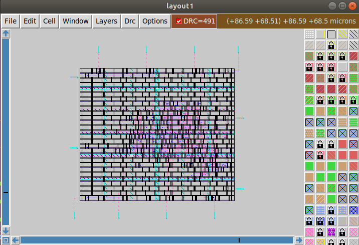
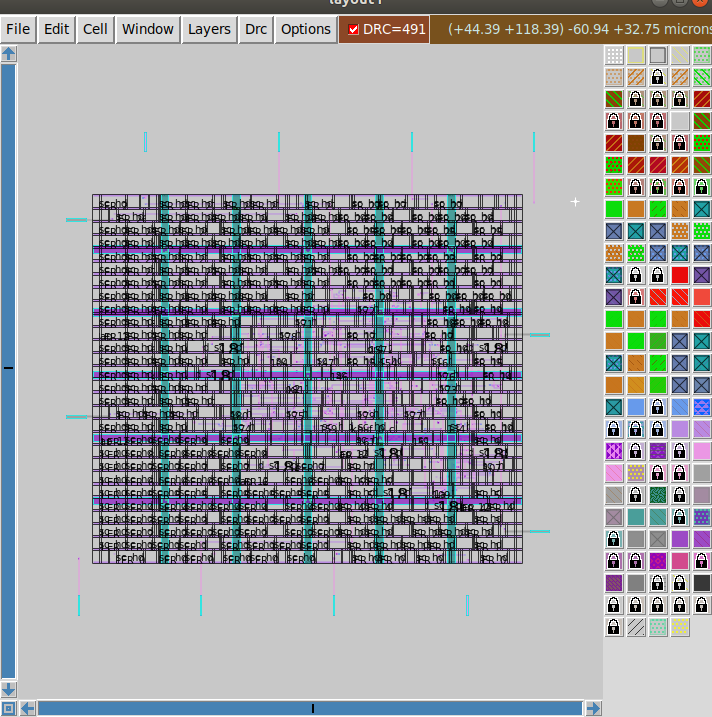
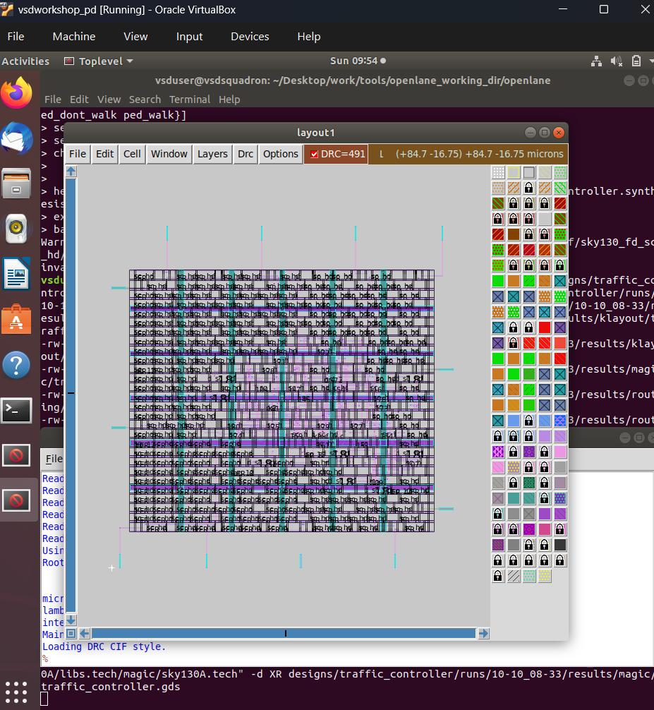
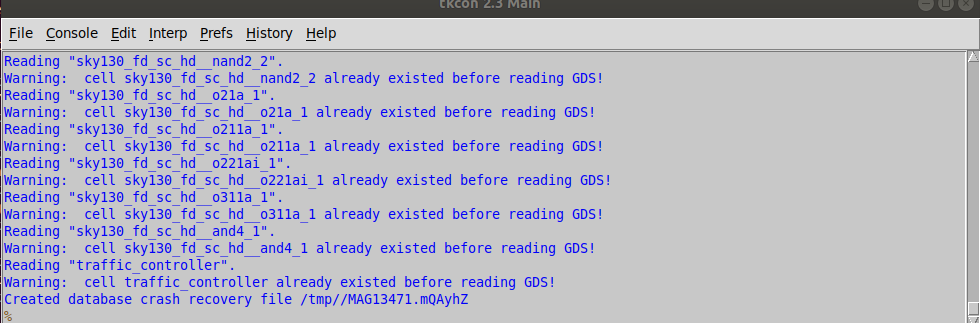

# Layout and the DRC discrepancy

## The two conflicting signals

| Source | DRC result |
|---|---|
| OpenLane flow log: "No DRC violations after GDS streaming out" | 0 |
| OpenLane Magic DRC summary (`reports/magic/39-magic.drc`) | "Total Magic DRC violations is 0" |
| `final_summary_report.csv` (`Magic_violations`) | 0 |
| Interactive Magic GUI opening the same GDS | **DRC=491** (red badge in the toolbar) |





**Status: unresolved.** This repository does not claim the layout is DRC-clean. Antenna (0 pins, 0 nets) and LVS
(0 errors) are independent results and are not affected by this question.

## Clues in the console



- For every standard cell, Magic prints `Warning: cell sky130_fd_sc_hd__xxx already existed before reading GDS!`,
  and the same for `traffic_controller`. The cell definitions were already in memory when the GDS was read.
- The log ends with `Created database crash recovery file /tmp//MAG....` and `Loading DRC CIF style.`
- The labels covering the layout (`sp hd`, `1.8f` style text) are cell/boundary labels, which makes the view busy but is not a DRC clue.
- The command line visible in the session loads `sky130A.tech` from the **host** PDK
  (`~/Desktop/work/tools/openlane_working_dir/pdks`), whereas the flow ran inside the Docker container with its own
  `/openLANE_flow` PDK.

## Hypotheses, most likely first

1. **Different DRC style or incomplete check state in the GUI.** The batch flow checks with the full DRC style
   (`drc(full)`); the GUI may use a different default style, and the `DRC=` counter can include errors that the flow
   deliberately filters or counts differently.
2. **Cells defined twice.** The "already existed" warnings mean the GDS read may have overwritten library cells that were
   preloaded (from the tech or maglef setup), so the checker sees mismatching cell definitions.
3. **PDK/tech version mismatch** between the host Magic setup and the container used for signoff.
4. **Counting convention.** The GUI counter is the number of error tiles/regions, not the number of unique violated
   rules, so one real or spurious issue can show up as hundreds.

These are hypotheses to test, not findings.

## Debug plan

In the Magic console after loading the GDS:

```tcl
drc style drc(full)        ;# use the same style as the batch flow
select top cell
drc catchup                ;# finish the check
drc count                  ;# per-cell count
drc listall why            ;# which rules are violated and where
```

Then:

1. Group the `drc listall why` output by rule. If everything is inside standard cells (for example the same rule repeated
   across instances), it points to a library/tech mismatch rather than a routing problem.
2. Re-open the GDS **inside the OpenLane container** with the same Magic and PDK as the flow
   (`make mount`, then run Magic there) and compare the count.
3. Open the same GDS in KLayout with the SKY130 DRC deck from the PDK (`libs.tech/klayout`) as an independent check.
4. Compare `traffic_controller.mag` / `.lef` / `.gds` timestamps in `results/magic` and `results/klayout` to confirm that the
   GUI opened the final GDS and not an earlier one.
5. Re-run the flow and re-check; the flow is only about 2 minutes long.

Update this page and the README with the outcome once resolved.
